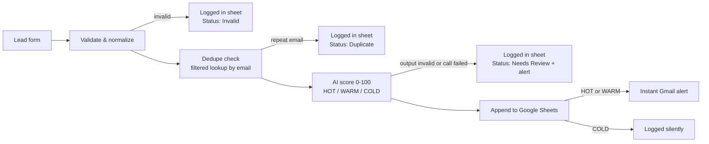

# Inbound Lead Triage — n8n + AI

**Never lose another lead.** Every enquiry that hits your form is validated, deduped, scored by AI, logged to Google Sheets, and — if it's worth your time — in your inbox within a minute.

Built by [Forethinq Labs](https://github.com/ForeThinq) as a working demo of the lead-flow automation we sell. Import it, connect your own accounts, and run it — everything below is exactly what the workflow does.

**Status:** Hardened version — 23 nodes. Retested on 9 Nov 2026 in a local n8n (2.46.6): all 5 sample cases behaved correctly, spam included. The model verdicts in that run came from Gemini 3.1 Flash-Lite (live calls; Sheets and Gmail stubbed); the workflow as shipped calls Gemini 3.8 Flash, which still needs its own live scoring run — see **Tested on**. The first live run was 5 Nov 2026 with real form submissions; the model behind those scores can't be verified because the saved execution output is gone.

## What this is

A **lead** is a potential customer who asks about your service. **Triage** means sorting those enquiries the moment they arrive, so the good ones get a reply first. This project is a working demo of a system that does exactly that, built as an importable n8n workflow.

**The problem.** Enquiries from a website form land in an inbox. They get read late, read twice, or missed completely, and the serious buyers quietly go to a competitor who replied faster. Nothing sorts them, nothing reminds anyone, and spam sits in the same list as real customers.

**What it does, in plain words.** Every time someone submits the form, the workflow checks the enquiry is genuine, checks the same person has not already enquired, and has AI read the message and score it: how serious is this person, and how good a fit are they for the business (HOT, WARM or COLD, with the reason written out). The enquiry is saved in one clean list in Google Sheets. If it is worth replying to, the owner gets an instant email alert with everything needed to respond. Spam and weak enquiries are still saved, but they never interrupt anyone.

**Who it is for.** Any small business that receives enquiries through a website and loses them in a shared inbox: clinics, real-estate offices, salons, agencies, home services, consultants. In a client build, the form, the scoring rules and the alert all run inside that business's own accounts.

<!-- SCREENSHOTS — embeds ready, uncomment each line when the matching file lands in assets/ (see shot list; nothing here is faked, all captures are from a real local run)

-->

## How it works

1. **Lead Form** — a hosted n8n form (name, email, phone, company, service, budget, message).
2. **Validate & Normalize** — cleans the input and lowercases the email. An invalid submission (no name, bad email, empty message) is still logged in the sheet with Status **Invalid** — never dropped silently.
3. **Dedupe Check** — a filtered lookup reads only the rows for this one email address (it no longer reads the whole sheet). A repeat enquiry is logged with Status **Duplicate**: no second scoring, no second alert.
4. **AI Classify (Gemini 3.8 Flash)** — scores the lead 0–100 with a category (HOT / WARM / COLD), a one-line reason, and a suggested next step, judged on fit, budget, and urgency. The form text goes into the prompt marked as data, not commands.
5. **Parse & Validate** — the AI's answer is checked field by field. Bad output or a failed call never becomes a made-up score: the lead is logged with Status **Needs Review** and gets its own alert.
6. **Append to Leads Sheet** — the full record, with score and reasoning, lands in one clean row.
7. **Instant Alert** — HOT and WARM leads trigger an immediate Gmail alert with everything you need to reply. COLD leads are logged silently.
8. **Error workflow** (separate file) — if anything in the chain fails, you get a failure alert naming the node and the error, so a lead is never lost silently.

## Tested results (real run, sample leads)

| Sample lead | Score | Category | What happened |
|---|---|---|---|
| Priya Sharma — SmileCare Dental Clinic, WhatsApp assistant, $400–$800 | 95 | HOT | Sheet row + instant alert |
| Mark Jensen — Jensen Realty, workflow automation, $150–$400 | 95 | HOT | Sheet row + instant alert |
| Ananya Desai — Glow & Co Salon, WhatsApp assistant, under $150 | 62 | WARM | Sheet row + alert — small budget, but the need is real |
| Priya Sharma again (same email) | — | Duplicate | Logged as Duplicate — no second score, no second alert |
| Ravi Kumar — spam pitch | 0 | COLD | Logged, no alert — verified in the 9 Nov 2026 retest (see **Tested on**) |

Full sample data, with the expected result for each lead: [`sample-leads.csv`](sample-leads.csv).

## Tested on

**9 Nov 2026 — the hardened workflow (the files in this repo), in a local n8n 2.46.6.** All 5 sample cases behaved correctly: Priya Sharma scored HOT 95 with an alert; Mark Jensen HOT 95; Ananya Desai WARM; the repeat Priya submission was caught as a duplicate; the Ravi Kumar spam pitch scored COLD 0, logged with no alert. The prompt-injection case was ignored as instructions and scored COLD 20. An empty-fields submission was logged as Invalid.

- **Tested live:** the AI scoring calls (real Gemini API). The model answering in this run was **Gemini 3.1 Flash-Lite** (temp 0.2).
- **Tested with stubbed nodes:** Google Sheets and Gmail were stand-ins in that run; the sheet writes, dedupe lookup and alert sends follow the tested node logic but were not exercised against a real Google account in this run.
- **Still needs a live test:** scoring on **Gemini 3.8 Flash** — the model the shipped workflow calls. It returned 503/429 errors on the test day, so its scores are not yet verified. A standalone run of the scoring prompt on 3.1 Flash-Lite the same day matched expectations (Priya 95 HOT, Mark 95 HOT, Ananya 65 WARM, Ravi 0 COLD).

## Sample input → output

**In** (form submission):

> Priya Sharma, SmileCare Dental Clinic — "We miss a lot of appointment enquiries on WhatsApp after clinic hours. Patients ask about prices and timings and nobody replies till morning, so they book elsewhere. Can you build an assistant that answers and books appointments?" — Budget $400–$800

**Out** (one Sheet row + one alert email):

| Score | Category | AI reason | Next action |
|---|---|---|---|
| 95 | HOT | High-intent clinic needing a WhatsApp AI booking assistant | Discovery call |

## Failure handling (the part most demos skip)

- **Duplicate submissions** are detected by email and logged with Status **Duplicate** — no second score, no second alert.
- **Invalid submissions** (no name, bad email, empty message) are logged in the sheet with Status **Invalid** — never dropped silently.
- **AI unavailable or returns junk** → the lead is logged with Status **Needs Review** and its own alert. It never gets an invented score.
- **Every outside call retries 3 times** (Gemini, Sheets, Gmail). After that, a failed sheet write or alert stops the run loudly.
- **Any node fails** → the companion error workflow emails you the failing node and error message.

## Known limits

- **Dedupe keys on the email address only.** The same person writing from a different email address counts as a new lead.
- **Two submissions at the same moment can both slip past dedupe.** Both can pass the lookup before either row is written, because a spreadsheet has no lock.
- **An Invalid row does not block a corrected resubmission.** If someone's first attempt was invalid, their fixed second attempt is processed normally. Duplicate and Needs Review rows do count as existing.
- **The error workflow cannot be linked inside an exported file.** After import, select it once in the main workflow's Settings (setup step 7 above).
- **Scores depend on the model.** The shipped workflow calls Gemini 3.8 Flash; the latest retest ran on Gemini 3.1 Flash-Lite. After any model change, the results need a retest before they can be trusted.

## Tech stack

| Piece | Used for |
|---|---|
| n8n | Workflow engine — form, logic, orchestration (23 nodes + 2-node error workflow) |
| Google Gemini 3.8 Flash | Lead scoring and reasoning (free API key from Google AI Studio) |
| Google Sheets | Lead log — also the dedupe source of truth |
| Gmail | Instant alerts for HOT / WARM leads, and failure alerts |

## Files

| File | What it is |
|---|---|
| `workflow-lead-triage.json` | The main workflow — import into n8n |
| `workflow-error-handler.json` | The error workflow — import, then select it in the main workflow's Settings |
| `sample-leads.csv` | 5 test leads (hot, warm, cold/spam, a duplicate, a borderline case) with expected results |

## Setup (10 minutes)

1. **Install n8n** locally (`npx n8n`) or use any n8n instance.
2. **Import both JSON files** (Workflows → ⋯ → Import from File).
3. **Create a Google Sheet** with a tab named `Leads` and these headers in row 1:
   `Received At | Name | Email | Phone | Company | Service | Budget | Message | Score | Category | Reason | Next Action | Status`
4. **Connect your Google account** in all the Google Sheets nodes and both Gmail nodes (OAuth, one click each), and point every Sheets node at your sheet (replace `YOUR_GOOGLE_SHEET_ID`).
5. **Get a free Gemini API key** from [Google AI Studio](https://aistudio.google.com/apikey) and replace `YOUR_GEMINI_API_KEY` in the **x-goog-api-key header** of the *AI Classify — Gemini* node. The key never goes in the URL.
6. **Replace `YOUR_EMAIL@example.com`** in both Gmail nodes with the inbox that should receive alerts.
7. **Error workflow:** open the main workflow → Settings → Error Workflow → select *Error Handler — Lead Triage Alerts*.
8. **Activate** the workflow and open the form URL (`/form/lead-intake`) to submit test leads from `sample-leads.csv`.

## Try it against the samples

Submit the rows from `sample-leads.csv` one at a time and compare with the results table above: the strong leads score HOT with alerts, the repeat Priya submission is skipped as a duplicate, the spam scores COLD with no alert, and the salon enquiry scores WARM despite the tiny budget — because the *need* is real.

## Make it yours

In a client build, the same skeleton adapts to your business:

- **Form fields** — your services, your budget bands, your qualifying questions.
- **Scoring prompt** — your ideal client, your minimum budget, your red flags.
- **Destination** — Google Sheets here; a CRM or a different sheet layout works the same way.
- **Alerts** — Gmail here; the alert can go to whoever owns follow-up.

## Want this for your business?

This demo is a template of what Forethinq Labs builds for clients — lead capture → AI triage → CRM/Sheets → instant follow-up, inside **your** accounts, at a fixed price.

📧 forethinq@gmail.com · [GitHub](https://github.com/ForeThinq) · [Reddit](https://www.reddit.com/user/ForeThinq/)
