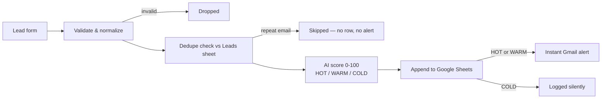

# Inbound Lead Triage — n8n + AI

**Never lose another lead.** Every enquiry that hits your form is validated, deduped, scored by AI, logged to Google Sheets, and — if it's worth your time — in your inbox within a minute.

Built by [Forethinq Labs](https://github.com/ForeThinq) as a working demo of the lead-flow automation we sell. Import it, connect your own accounts, and run it — everything below is exactly what the workflow does.

**Status:** Live-tested on 5 Nov 2026 with real form submissions — 4 of 5 sample cases verified end to end (scores, sheet rows, alerts, duplicate skip). The final spam-case check is still being run. Results table below.

<!-- SCREENSHOTS — embeds ready, uncomment each line when the matching file lands in assets/ (see shot list; nothing here is faked, all captures are from a real local run)

-->

## How it works

1. **Lead Form** — a hosted n8n form (name, email, phone, company, service, budget, message).
2. **Validate & Normalize** — cleans the input, lowercases the email, drops junk submissions before they touch anything.
3. **Dedupe Check** — compares the email against the Leads sheet. A repeat enquiry is skipped: no second row, no second alert.
4. **AI Classify (Gemini 3.8 Flash)** — scores the lead 0–100 with a category (HOT / WARM / COLD), a one-line reason, and a suggested next step, judged on fit, budget, and urgency.
5. **Append to Leads Sheet** — the full record, with score and reasoning, lands in one clean row.
6. **Instant Alert** — HOT and WARM leads trigger an immediate Gmail alert with everything you need to reply. COLD leads are logged silently.
7. **Error workflow** (separate file) — if anything in the chain fails, you get a failure alert naming the node and the error, so a lead is never lost silently.

## Tested results (real run, sample leads)

| Sample lead | Score | Category | What happened |
|---|---|---|---|
| Priya Sharma — SmileCare Dental Clinic, WhatsApp assistant, $400–$800 | 95 | HOT | Sheet row + instant alert |
| Mark Jensen — Jensen Realty, workflow automation, $150–$400 | 95 | HOT | Sheet row + instant alert |
| Ananya Desai — Glow & Co Salon, WhatsApp assistant, under $150 | 62 | WARM | Sheet row + alert — small budget, but the need is real |
| Priya Sharma again (same email) | — | Duplicate | Skipped — no second row, no second alert |
| Ravi Kumar — spam pitch | — | Expected COLD | Final check in progress |

Full sample data, with the expected result for each lead: [`sample-leads.csv`](sample-leads.csv).

## Sample input → output

**In** (form submission):

> Priya Sharma, SmileCare Dental Clinic — "We miss a lot of appointment enquiries on WhatsApp after clinic hours. Patients ask about prices and timings and nobody replies till morning, so they book elsewhere. Can you build an assistant that answers and books appointments?" — Budget $400–$800

**Out** (one Sheet row + one alert email):

| Score | Category | AI reason | Next action |
|---|---|---|---|
| 95 | HOT | High-intent clinic needing a WhatsApp AI booking assistant | Discovery call |

## Failure handling (the part most demos skip)

- **Duplicate submissions** are detected by email and skipped.
- **Invalid submissions** (no name, bad email, empty message) are dropped before they touch the sheet.
- **AI unavailable or returns junk** → the lead still gets logged with a safe fallback score (50 / WARM) and a "review manually" flag.
- **Any node fails** → the companion error workflow emails you the failing node and error message.

## Tech stack

| Piece | Used for |
|---|---|
| n8n | Workflow engine — form, logic, orchestration (15 nodes + 2-node error workflow) |
| Google Gemini 3.8 Flash | Lead scoring and reasoning (free API key from Google AI Studio) |
| Google Sheets | Lead log — also the dedupe source of truth |
| Gmail | Instant alerts for HOT / WARM leads, and failure alerts |

## Files

| File | What it is |
|---|---|
| `workflow-lead-triage.json` | The main workflow — import into n8n |
| `workflow-error-handler.json` | The error workflow — import, then select it in the main workflow's Settings |
| `sample-leads.csv` | 5 test leads (hot, warm, cold/spam, a duplicate, a borderline case) with expected results |

## Setup (10 minutes)

1. **Install n8n** locally (`npx n8n`) or use any n8n instance.
2. **Import both JSON files** (Workflows → ⋯ → Import from File).
3. **Create a Google Sheet** with a tab named `Leads` and these headers in row 1:
   `Received At | Name | Email | Phone | Company | Service | Budget | Message | Score | Category | Reason | Next Action | Status`
4. **Connect your Google account** in the two Google Sheets nodes and the Gmail node (OAuth, one click each), and select your sheet in the Sheets nodes.
5. **Get a free Gemini API key** from [Google AI Studio](https://aistudio.google.com/apikey) and replace `YOUR_GEMINI_API_KEY` in the *AI Classify — Gemini* node.
6. **Replace `YOUR_EMAIL@example.com`** in both Gmail nodes with the inbox that should receive alerts.
7. **Error workflow:** open the main workflow → Settings → Error Workflow → select *Error Handler — Lead Triage Alerts*.
8. **Activate** the workflow and open the form URL (`/form/lead-intake`) to submit test leads from `sample-leads.csv`.

## Try it against the samples

Submit the rows from `sample-leads.csv` one at a time and compare with the results table above: the strong leads score HOT with alerts, the repeat Priya submission is skipped as a duplicate, the spam scores COLD with no alert, and the salon enquiry scores WARM despite the tiny budget — because the *need* is real.

## Make it yours

In a client build, the same skeleton adapts to your business:

- **Form fields** — your services, your budget bands, your qualifying questions.
- **Scoring prompt** — your ideal client, your minimum budget, your red flags.
- **Destination** — Google Sheets here; a CRM or a different sheet layout works the same way.
- **Alerts** — Gmail here; the alert can go to whoever owns follow-up.

## Want this for your business?

This demo is a template of what Forethinq Labs builds for clients — lead capture → AI triage → CRM/Sheets → instant follow-up, inside **your** accounts, at a fixed price.

📧 forethinq@gmail.com · [GitHub](https://github.com/ForeThinq) · [Reddit](https://www.reddit.com/user/ForeThinq/)
